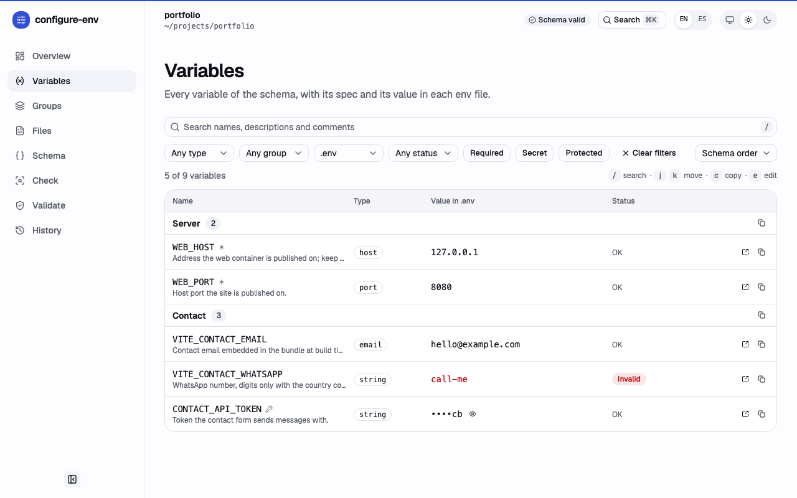
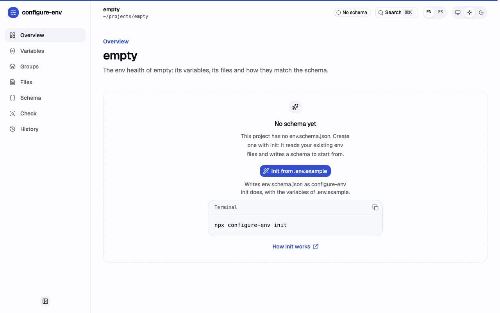

# configure-env

Configure, check and edit env files from a schema, interactively or in CI.

[](https://www.npmjs.com/package/@elvisgastelum/configure-env) [](https://github.com/elvisgastelum/configure-env/actions/workflows/ci.yml)

One JSON file describes a project's env files and the variables they hold. `configure-env` writes those files from it, keeps the ones you edit by hand, checks them for drift in CI, and edits single variables without touching the rest of the file. Secrets stay out of committed templates such as `.env.example`.

The CLI reads a JSON schema that lists the env files (their paths and write policies) and the variables (names, types and validation rules), then works from it:

| Command    | Purpose                                            |
| ---------- | -------------------------------------------------- |
| `apply`    | write the env files the schema describes           |
| `check`    | report every problem by file; fixes git-ignore lines |
| `init`     | start a schema for a project                       |
| `set`      | set one variable                                   |
| `get`      | print one variable                                 |
| `unset`    | remove one variable                                |
| `list`     | list the variables and where they are set          |
| `history`  | list the latest changes to env files and the schema |
| `install`  | install the agent skill, or register the MCP server, for Claude Code and others |
| `mcp`      | serve the env files to an agent over MCP, never revealing a secret |

Each command runs as an interactive TUI for people, or with `--ci` for unattended runs.

## Quick start

It needs Node.js 22 or later, and runs without installing:

```sh
# 1. Start a schema; the variables are inferred from .env.example when it exists.
npx @elvisgastelum/configure-env init

# 2. Edit env.schema.json: types, defaults, required and secret variables, and
#    the files to write (see "Schema" below).

# 3. Write the env files, answering the prompts.
npx @elvisgastelum/configure-env apply

# 4. In CI, fail when a committed file drifts from the schema or holds an
#    invalid entry.
npx @elvisgastelum/configure-env check --ci --file .env.example
```

To pin the version for a team, install it as a dev dependency and call the `configure-env` bin from a script:

```sh
pnpm add -D @elvisgastelum/configure-env   # or npm install -D, yarn add -D
pnpm exec configure-env check
```

## Schema (v1)

A project describes its env files in `env.schema.json` at its root. The format is versioned; this is version 1.

```json
{
  "$schema": "https://raw.githubusercontent.com/elvisgastelum/configure-env/main/schema/env.schema.v1.json",
  "version": 1,
  "variables": {
    "WEB_HOST": {
      "type": "host",
      "description": "Address the site is published on",
      "group": "Server",
      "default": "127.0.0.1",
      "required": true,
      "example": "192.168.1.115"
    },
    "WEB_PORT": { "type": "port", "default": 8080 },
    "API_TOKEN": { "type": "string", "secret": true, "minLength": 20 },
    "MODE": { "type": "enum", "values": ["dev", "prod"], "default": "dev" }
  },
  "files": [
    { "path": ".env.example", "policy": "merge", "variables": "*" },
    {
      "path": "deploy/.env.production.example",
      "policy": "generate",
      "header": "Generated by configure-env",
      "variables": ["WEB_HOST", "WEB_PORT"],
      "values": { "WEB_HOST": "192.168.1.<CT ID>" }
    },
    { "path": ".env", "policy": "create-only", "mode": "600", "variables": "*" }
  ]
}
```

[`packages/cli/examples/portfolio.env.schema.json`](packages/cli/examples/portfolio.env.schema.json) is a complete schema: the env setup of elvisgastelum.com.

Every object is strict: an unknown or misspelled key is an error, not ignored. The top level holds only `$schema`, `version` (must be `1`), `variables` and `files`.

### Variables

`variables` maps each name to its spec. A name matches `^[A-Za-z_][A-Za-z0-9_]*$`.

| Field         | Type    | Meaning                                                                             |
| ------------- | ------- | ----------------------------------------------------------------------------------- |
| `type`        | string  | one of the types below; required                                                    |
| `description` | string  | what the variable is for                                                            |
| `group`       | string  | a heading that groups related variables                                             |
| `required`    | boolean | the variable must be set; default `false`                                           |
| `allowEmpty`  | boolean | an empty value is accepted; default `true` when not required, `false` when required |
| `default`     | typed   | the value used when none is given; it must pass the variable's own rules            |
| `example`     | typed   | a sample value shown to people; it must pass the variable's own rules too           |
| `secret`      | boolean | mask the value in output (`••••` and the last 2 characters past 8); default `false` |
| `comment`     | string  | written as `#` lines above the key in generated, created and appended entries; `\n` starts a new line |
| `requiredUnless` | name or list | the variable is required unless one of these is set; not with `required: true` |
| `conflictsWith` | name or list | the variable and one of these must not both be set                          |
| `distinctFrom` | name or list | when the variable and one of these are both set, their values must differ      |
| `within`      | name    | on `ipv4`, `ipv6`, `ip` and `cidr`: a `cidr` variable whose network the value must lie inside (see "Networks") |
| `protected`   | `true` or `{ "reason" }` | once a file holds a value, never replace or remove it silently; needs `secret: true` (see "Protected variables") |

`default` and `example` take the type's JSON type: a number for `number`, `integer` and `port`, a boolean for `boolean`, a string for the rest.

| Type      | Accepts                                                                    | Options                                               |
| --------- | -------------------------------------------------------------------------- | ----------------------------------------------------- |
| `string`  | any text                                                                   | `minLength`, `maxLength`, `pattern`, `patternMessage`, `encoding`, `bytes` |
| `number`  | a decimal number, like `0.5` or `1e3`                                      | `min`, `max`                                          |
| `integer` | a whole number                                                             | `min`, `max`                                          |
| `boolean` | `true`/`false`, `1`/`0`, `yes`/`no`, `on`/`off`; written as `true`/`false` | none                                                  |
| `enum`    | one of `values`, matched case-sensitively                                  | `values` (required)                                   |
| `email`   | an email address                                                           | none                                                  |
| `url`     | an absolute URL                                                            | `protocols`, like `["https"]`; any scheme when absent |
| `host`    | a hostname, or an IPv4 or IPv6 address                                     | none                                                  |
| `ipv4`    | an IPv4 address                                                            | `within`                                              |
| `ipv6`    | an IPv6 address, without a zone (`%eth0`)                                  | `within`                                              |
| `ip`      | an IPv4 or IPv6 address                                                    | `within`                                              |
| `cidr`    | a CIDR block, `address/prefix`, like `10.0.0.0/8` or `fd00::/8`            | `family`, `strict`, `within`                          |
| `port`    | a whole number from 1 to 65535                                             | none                                                  |

`pattern` is a JavaScript regular expression in Unicode mode; `patternMessage` replaces the default error when a value does not match. An option of another type (say `minLength` on a `port`) is an error.

`encoding` makes a `string` hold bytes: `base64` (standard alphabet, with its `=` padding), `base64url` (URL-safe alphabet, without padding) or `hex` (either case, an even number of digits). The value must be canonical, as the encoding writes it, so whitespace, the other base64 alphabet or a wrong padding fails. `bytes`, which needs `encoding`, is the number of bytes it must decode to: `{ "type": "string", "encoding": "base64", "bytes": 32 }` takes what `openssl rand -base64 32` prints. The error names the rule, never the value: `must be base64 that decodes to 32 bytes`. `minLength`, `maxLength` and `pattern` apply too; with `bytes` the length is fixed, so a `minLength` above it or a `maxLength` below it is a schema error.

### Rules between variables

`requiredUnless`, `conflictsWith` and `distinctFrom` each take a declared variable name or a non-empty list of them, never the variable itself. A value counts as set when it is not empty.

```json
"SM_MASTER_KEY": {
  "type": "string",
  "secret": true,
  "encoding": "base64",
  "bytes": 32,
  "requiredUnless": "SM_MASTER_KEY_FILE",
  "conflictsWith": "SM_MASTER_KEY_FILE"
},
"SM_MASTER_KEY_FILE": { "type": "string" },
"SM_PREVIOUS_MASTER_KEY": {
  "type": "string",
  "secret": true,
  "encoding": "base64",
  "bytes": 32,
  "distinctFrom": "SM_MASTER_KEY"
}
```

The rules hold per file, over that file's own variables: a name the file does not list is left out of the rule there, and a rule left with no name is ignored for that file. A conflict is symmetric and reported once per pair, whichever side declares it. `distinctFrom` compares the values as a reader of the file gets them, unquoted. Templates hold placeholders, so their rules are not checked. The messages name the keys, never a value:

```text
.env: SM_MASTER_KEY: required unless SM_MASTER_KEY_FILE is set
.env: SM_MASTER_KEY, SM_MASTER_KEY_FILE: set only one of them
.env: SM_PREVIOUS_MASTER_KEY: must differ from SM_MASTER_KEY
```

`check` reports them and exits 1, `list` shows them in the `VALID` column, and `apply` and `set` refuse to write a file that would break one (exit 1). In generated files, a `requiredUnless` variable's comment ends with `required unless X is set` (`X or Y` for several).

### Networks

`ipv4` takes four decimal octets, each at most 255, with no leading zero; `ipv6` takes the standard forms (`::1`, `fd00::10`, `::ffff:1.2.3.4`) but no zone; `ip` takes either. `cidr` takes an address and a decimal prefix length, with no sign or leading zero, at most 32 for IPv4 and 128 for IPv6. Its options:

| Option   | Values                     | Meaning                                                                                       |
| -------- | -------------------------- | --------------------------------------------------------------------------------------------- |
| `family` | `ipv4`, `ipv6`, `any`      | the family the block must be; default `any`                                                   |
| `strict` | boolean                    | refuse a block with host bits set, like `10.0.0.1/8`; default `false`                         |

A strict error suggests the network address, `host bits are set; use 10.0.0.0/8`, except for a `secret` variable, whose error says only `use the network address`. `family` and `strict` on another type are schema errors.

`within` ties an address, or a block, to a `cidr` variable's network:

`"APP_SUBNET": {"type": "cidr", "family": "ipv4", "default": "172.30.250.0/24"}, "WEB_ADDRESS": {"type": "ipv4", "default": "172.30.250.10", "within": "APP_SUBNET"}`

The address must lie inside the network; a `cidr` variable's whole block must, so its prefix is at least as long. A different family is never within. `within` names one declared `cidr` variable, never the variable itself; a target whose `family` can never match the variable's is a schema error. Like the other rules, it holds per file and only when both values are set and valid for their types, `check` and `list` report it, and `apply` and `set` refuse a file that breaks it (exit 1), naming both keys and never a value:

```text
.env: WEB_ADDRESS: must be within APP_SUBNET
```

The loader checks the schema itself too: the variable's `default` and `example` against the target's `default` (`invalid default: WEB_ADDRESS must be within the default of APP_SUBNET`), and, in each template file holding both keys, the values the template writes, its `values` or else the defaults (`files[0].values.WEB_ADDRESS: WEB_ADDRESS must be within APP_SUBNET`). A template value that is not valid for its type is a placeholder and is not checked.

### Protected variables

Some values must never change once data depends on them: an encryption master key, or a database password baked into a volume. Mark them `protected`, with an optional reason; a protected variable must be `secret: true` (the loader errors otherwise):

```json
"SM_MASTER_KEY": {
  "type": "string",
  "secret": true,
  "encoding": "base64",
  "bytes": 32,
  "protected": { "reason": "it encrypts the vault" }
}
```

Once a non-template file holds a non-empty protected value:

- `set` with a different value (`KEY=VALUE`, `--stdin`, `--prompt`, `--generate`) exits 2 and writes nothing; the same value reports `unchanged`.
- `unset` exits 2.
- `apply` exits 2 and writes nothing when a file of the run would change it, such as a `generate`-policy file rendering another value.

A key that is missing or empty, in a file whose earlier value the state recorded, takes only that value back (the restore path) or an empty one (`--defer`). Any other value exits 2: an `apply --generate` that recreates a deleted `.env`, a `set --generate` after an `unset`, or a value from `--set`, the environment or a default. The errors name the key and the reason, never a value:

```text
SM_MASTER_KEY: is protected (it encrypts the vault); pass --replace-protected SM_MASTER_KEY to change it
SM_MASTER_KEY was set on 2026-10-10; restore it from your backup, or pass --replace-protected SM_MASTER_KEY
```

`--replace-protected KEY` (repeatable; on `set`, `unset` and `apply`) allows the change for that key only; there is no global force. In a terminal you confirm by typing the key's name: a wrong name exits 2 and a cancel 130, both writing nothing. With `--ci` or `--json` the flag alone is enough; without a terminal or either, it exits 2. The output says `replaced protected KEY`. Moving from a key to its file, say, takes `unset --replace-protected SM_MASTER_KEY SM_MASTER_KEY`, then `set SM_MASTER_KEY_FILE=…`.

The state is `.configure-env/state.db` under the root, a SQLite database, or the global `--state <path>` (relative to the root; never a schema file or a path inside one). `apply`, `set` and `unset` record each protected value they write, and each one the files they touch hold, only after the env files are written; a value replaced with the flag replaces its record, and one removed with it drops it. A value that differs from its record is left as it is, for `check` to report (exit 1):

```text
.env: SM_MASTER_KEY no longer matches the value recorded on 2026-10-10
```

`check` and `list` never write the state. A run that writes or holds a protected value opens a write transaction on the database (SQLite's `BEGIN IMMEDIATE`) before it writes any env file: in it, it re-reads the state, runs every protected check against it, writes the env files and applies only its own changes, then commits, so parallel runs, from the CLI or the portal, keep each other's fingerprints. A transaction held by another run makes it wait 2 seconds, then exit 1 with nothing written (`in use by another run; try again`). A run that crashes leaves nothing to clean up: SQLite rolls back its transaction. The database uses WAL mode, so a run can read the state while another writes it. It has mode 600, its directory 700, it is never opened through a symlink, and it holds only a salted HMAC of each protected value, never the value. Every write command (`set`, `unset`, `apply`, `init`, and the portal's writes) records what it changed in the history of edits, which `configure-env history` lists; a history it cannot write is a warning, never a failure. Its tables are:

| Table                    | What it holds                                                                                                                                                                                          |
| ------------------------ | ------------------------------------------------------------------------------------------------------------------------------------------------------------------------------------------------------ |
| `meta`                   | `schema_version` (the migrations applied) and `salt` (the base64 of 32 random bytes)                                                                                                                    |
| `protected_fingerprints` | per schema file and key, the hex HMAC-SHA-256(salt, value) and when it was recorded (`2026-10-10T12:00:00.000Z`)                                                                                         |
| `changes`                | the history of edits: `actor` (`cli` or `portal`), `file`, `key` (empty for the schema), `operation` (`set`, `unset`, `replace` or `schema`), the fingerprints and previews of the value before and after, `at`, the values before and after of a variable the schema declares and does not mark secret (or the schema's text) so the change can be undone (`restorable`), `undo_of`, and `not_kept` (`secret`, `undeclared` or `schema-created`: why no value was kept); never a secret's value, in any file, nor that of a key the schema does not declare |

The schema ships with the package as drizzle-kit migrations, applied when a run opens the database; a database written by a newer version is refused, never changed. A `.configure-env/state.json` written by an earlier version (the `state.json` next to the database) is read as it is until the first run that writes the state, which imports it in its transaction, checks every fingerprint arrived, and removes the file once the transaction commits. An import interrupted before the removal is finished by the next run; a `state.json` whose salt differs from the database's is refused (exit 1) until you remove one of them.

Fingerprints are per file: the same value copied to a second file is recorded there too. A state that is not valid exits 1, naming its path; it is never guessed at or replaced. `init` adds `.configure-env/` to `.gitignore`, and the first run that writes the state gives its directory a `.gitignore` of its own naming the database, its SQLite side files (`state.db-journal`, `state.db-wal`, `state.db-shm`) and `state.json`, so the state stays out of git even without the root's line. It writes one only into a directory it created or one named `.configure-env`, never over a `.gitignore` already there; one it cannot write never fails the run.

Limits: the state knows only this machine's history. A fresh clone has none, so its first value is accepted, and `git clean -fdx` deletes it. Generated, created and appended entries carry the comment line `protected: <reason>`, or `protected`, after the variable's own comment. Templates hold placeholders, so the field has no effect on them.

### Files

`files` lists the env files, in the order the tool handles them.

| Field         | Type          | Meaning                                                                                        |
| ------------- | ------------- | ---------------------------------------------------------------------------------------------- |
| `path`        | string        | relative to the project root, with `/`; no absolute paths, `..`, `.` or empty segments; unique |
| `policy`      | string        | `generate`, `merge` or `create-only` (below); required                                         |
| `variables`   | `"*"` or list | `"*"` for every variable in declaration order, or declared names in output order; required     |
| `mode`        | string        | the permissions as three octal digits, like `"600"`                                            |
| `header`      | string        | written as `#` lines at the top of the file                                                    |
| `template`    | boolean       | the file is a template (below); default `true` when the path ends in `.example`, `.sample` or `.template` |
| `values`      | object        | literal values for this file only, like placeholders in an example; written as is, not type-checked, no line breaks |
| `comments`    | object        | comments for this file only, replacing the variables' own `comment`; for this file's variables only |
| `description` | string        | what the file is for                                                                           |

| Policy        | What the tool does with the file                                              |
| ------------- | ----------------------------------------------------------------------------- |
| `generate`    | owns it: writes the whole file and rewrites it whenever it differs            |
| `merge`       | appends the keys it lacks, with their comments, and keeps every existing line |
| `create-only` | writes it only when it does not exist, then never touches it                  |

### Template files

A template file is committed with placeholders, like `.env.example`. A file is a template when its `template` is `true`, or when `template` is not set and its path ends in `.example`, `.sample` or `.template`; `"template": false` turns the suffix rule off.

A template takes only its `values` entries and the defaults. It never takes a `--set` value, an environment variable or a prompted value, so a secret cannot end up in a committed file, and `apply` asks for no variable that only template files need. `check` checks only a template's lines and keys, never its values, which are placeholders.

### How files are written

A generated or created file holds the `header` as `#` lines, a blank line, then each variable in the file's order: its comment as `#` lines (with the `requiredUnless` line after it), then `KEY=value`. A blank line separates blocks; a new block starts where the `group` changes or a variable has a comment. The value is the file's `values` entry, else the given value (never for a template), else the `default`, else empty.

A `merge` file keeps every existing line byte for byte, including its line endings, `export` prefixes, quotes and comments; the missing keys go at the end after a blank line, with their comments. Existing values are never changed.

A variable's comment is its `comment`, or the file's `comments` entry for it, then the `required unless …` and `protected: …` lines; `\n` in either starts a new `#` line, and an empty line is a bare `#`. It is written above the key wherever the tool writes the key: a generated or created file, a merge append, or a `set` append. When the tool removes a key (`unset`, `apply --prune`), the comment block above it goes too, and so does the blank line that set the block apart, so the file is left as a fresh `apply` would write it for the remaining keys: no doubled, leading or trailing blank line. Every other byte stays, line endings included.

Values are written plain when they can be. A value holding whitespace, `#` or quotes is double-quoted with backslash escapes. A value holding `$` is single-quoted, so Docker Compose and dotenv-expand do not interpolate it: `PASSWORD='pa$$word'`. When it also holds a single quote or a line break, it is double-quoted with `$` written as `\$`.

A file path that leaves the project root, directly or through a symlinked directory, is refused, and so is writing through a symlink. Each file is written atomically (a temporary file in the same directory, flushed, then renamed into place) with the schema's `mode`, else the existing file's mode, else `644`. A new file never replaces one that appeared after planning: it is hard-linked into place, or, on a file system without hard links, created exclusively.

An existing file whose content needs no change, under any policy (a create-only file included), but whose mode differs from the schema's `mode` gets a chmod only: its content is never rewritten and no value is asked for. The file is opened without following a symlink and the open file is changed (`fchmod`), so the umask does not apply; a file that changed after planning is left alone and reported as `failed`. The chmod only removes permissions: when the schema's `mode` would add a bit the file lacks (`600` on a `400` file), the file is left as it is and reported, and the run exits 1. A file whose content changes is written with the schema's `mode` as above. A template takes a mode only when it declares one. A chmod changes no value; like a skipped file, the protected values the file holds are recorded, under the lock, so a file holding none takes no lock.

A line that is not a valid entry, such as a quote that is never closed, is kept as is and reported by `check`; the lines after it parse on their own.

The loader accepts a schema file saved with a UTF-8 byte order mark. A `host` whose last label is all digits must be a valid IPv4 address, so `999.1.1.1` is rejected.

### Editor support

The `$schema` line points editors such as VS Code at [`packages/cli/schema/env.schema.v1.json`](packages/cli/schema/env.schema.v1.json), which gives completion, hover docs and inline errors while editing. The same file ships in the package as `@elvisgastelum/configure-env/schema.json`, for tools that read it from `node_modules`. The JSON Schema checks the shape; the loader also checks what JSON Schema cannot express: defaults and examples against their type's rules, `bytes` without `encoding`, the names in the rules between variables, variable names in `files`, value overrides, and unique paths.

The JSON Schema is generated from the zod definition in `packages/core/src/schema/definition.ts`. After changing the definition, run `pnpm schema:generate` and commit the result; a test and CI (`pnpm schema:check`) fail while it is stale.

## Usage

```sh
configure-env [command] [options]
```

Run it with `npx @elvisgastelum/configure-env <command>`, or as `configure-env <command>` once installed. From a checkout of this repo, `pnpm start -- <command> [options]` runs the sources; `--root` points it at a project.

| Command | What it does                                                         |
| ------- | -------------------------------------------------------------------- |
| `apply` | writes the env files the schema describes; the default command       |
| `check` | reports every problem by file, exits 1 on any error; writes only the git-ignore lines it fixes |
| `init`  | writes a starting `env.schema.json`, inferred from an example env file |
| `set`   | sets variables in one file, keeping every other byte                   |
| `get`   | prints one variable's value                                            |
| `unset` | removes variables from one file                                        |
| `list`  | shows each file's variables: set, valid, value (secrets masked)        |
| `history` | lists the latest changes the CLI and the portal made (see "history") |
| `install` | `install skill` installs the agent skill (see "AI agents")           |
| `serve` | starts the local portal for the project in a browser (see "Portal (serve)") |

`configure-env <command> --help` shows each command's options and examples.

### Global options

| Option            | Meaning                                                                       |
| ----------------- | ----------------------------------------------------------------------------- |
| `--schema <path>` | the schema file; default `env.schema.json` in the root                        |
| `--root <dir>`    | the project root; default where the command was typed (`INIT_CWD`, else cwd)  |
| `--state <path>`  | the protected variables' state, relative to the root; default `.configure-env/state.db`   |
| `--file <path>`   | only this schema file; repeat it for more (`set`, `get` and `unset` take one) |
| `--ci`            | never prompt; also when the `CI` environment variable is set (not `false`/`0`) |
| `--json`          | print one JSON document on stdout, logs on stderr; implies no prompts         |
| `--no-color`      | plain output; `NO_COLOR` is honoured too                                      |
| `-h`, `--help`    | the help, of the CLI or of a command                                          |
| `-v`, `--version` | the version                                                                   |

A missing schema exits 2 with a hint to run `configure-env init`; an invalid one exits 1 and names each problem.

### apply

In a terminal, `apply` shows the schema files with their policy and current state and asks which to write. It then prompts, grouped by `group`, for the values the chosen files need: every variable of a generate file or a file it creates, and the keys a merge file lacks. A variable a file sets through `values` is not asked for, and neither is one given with `--set` or one only template files need. Each prompt fits the type: a select for an `enum`, a yes/no for a `boolean`, a hidden input for a `secret`, and text for the rest, starting from the default and checked against the variable's rules. It shows the plan (secrets masked), asks before writing, and writes. Ctrl-C at any prompt exits 130 and writes nothing. A create-only file that exists is skipped; a refused path is reported with its reason. A file whose mode differs from the schema's shows it in its state (`mode 644, expected 600`), is chosen by default, and the plan lists the chmod (`fix mode (644 → 600)`).

With `--ci`, or `CI=true`, it never prompts. Each value comes from `--set KEY=VALUE`, else the environment variable of the same name (when not empty), else the schema default. A required variable that ends up with no value, any invalid value, or a file whose values would break a rule between variables (for the rules that name a key the run writes to it), is an error: nothing is written and it exits 1. In a terminal the same rules are checked before the plan is shown. It prints one line per file:

```text
config/app.env: created
.env.example: added keys: WEB_PORT
.env: skipped (exists)
```

Other states are `updated`, `pruned keys: A, B` (see `--prune`; `added keys: C; pruned keys: A, B` when the run does both), `unchanged`, `mode fixed (644 → 600)`, `mode not loosened (400, schema says 600)` (exit 1), `skipped (refused: <reason>)` and `failed (<reason>)`. Without a terminal and without `--ci` it exits 2.

A file whose content is current but whose mode differs from the schema's `mode` is chmodded, never rewritten (see "How files are written"): that brings an existing create-only `.env` created `644` to its `600`. A second run reports it as usual (`skipped (exists)` or `unchanged`) and exits 0.

`--generate KEY` (repeatable) acts like `--set` with a random value for a variable declared `type: "string"` and `secret: true`: 48 characters of `[A-Za-z0-9_-]` from `node:crypto`, within `minLength` and `maxLength`, one value per run for every file. A `maxLength` under 16 is a usage error (exit 2): a value that short is too weak to generate, so set it with `--prompt` or `--stdin`. A variable with `encoding` gets `bytes` random bytes (32 when not set) in that encoding instead; `bytes` under 16 is the same usage error. A base64 value is written unquoted: `+`, `/` and `=` need no quotes, and readers get it back unchanged. It is never printed. Merge and create-only files never change a value, so it lands only where a file lacks the key. When a non-template file of the run already holds a non-empty value for the key, that value is reused instead of a new one, so a rerun after one file was deleted writes the same secret the others keep; two files of the run holding different values exit 2, naming the files and never a value. A key is a usage error (exit 2) when a file of the run that writes it also lists its `conflictsWith` partner with a value (held by the file, or written by the run: given, from the environment, or a default), so the run never writes both; a partner the file does not list is no conflict. A chosen non-template file with policy `generate` that writes the key is a usage error (exit 2), since it would rotate the secret on every run; so is a key also given with `--set`, or one that is not a secret string. A random value is made only when a file of the run writes the key; one that cannot pass the variable's rules (a `pattern`, say) exits 1 and writes nothing. In a terminal the key is not prompted for.

`--replace-protected KEY` (repeatable) lets the run change a protected value; see "Protected variables". Every protected key a file of the run would write is checked before anything is written.

`--prune` removes the keys a `merge` file, or an existing `create-only` file, holds that the schema does not list for it: a variable deleted from the schema, or a key added by hand. Each goes with its comment block, the `#` lines directly above it with no blank line between; a comment set apart by a blank line stays. The blank line rule of `unset` applies. Generate files need no pruning, since they are rewritten. It is opt-in because it deletes keys a person may have added on purpose, and without it `apply` keeps every key. The terminal plan lists the keys to prune (`prune keys: A, B`); the output never shows a value. A pruned key that has a protected fingerprint loses it, in the state's write transaction. When the schema protects no variable, that is a best effort: a state that cannot be read, or one another run holds, keeps the fingerprints and, when the run prunes a key, prints a warning without failing the run: `configure-env: warning: .configure-env/state.db: cannot be read (is not a valid state database); fingerprints of pruned keys, if any, were kept`, or, when a pruned key had one, `not written (<reason>); fingerprints of pruned keys were kept`; a missing state is never created. `check` reports the keys it would remove as warnings, and as errors with `--strict`.

`--defer KEY` (repeatable) leaves a required variable, or a `requiredUnless` one, for a person to set later. When it ends up with no value, it is written empty, as an empty optional value is, instead of failing the run; in a terminal it is not prompted for. A value from `--set`, `--generate`, the environment or the default is written as usual. Every other required variable still needs a value. A key that is neither `required: true` nor `requiredUnless`, one also given with `--set` or `--generate`, or one the schema does not declare, is a usage error (exit 2). The run reports the keys it left empty after the file lines, leaving out a `requiredUnless` key whose alternative the file sets, and `check` fails on them until they are set:

```text
.env.example: created
.env: created
deferred: API_TOKEN (set it with configure-env set --file .env --prompt API_TOKEN)
```

```sh
configure-env apply
configure-env apply --ci --set WEB_PORT=9090
configure-env apply --ci --generate SESSION_SECRET
configure-env apply --ci --generate SESSION_SECRET --defer API_TOKEN
WEB_HOST=10.0.0.5 configure-env apply --ci --file .env
configure-env apply --ci --prune
configure-env apply --ci --json
```

### check

`check` writes nothing but the git-ignore lines it fixes. It prints one report of every problem the env files have against the schema, file by file in schema order, and exits 1 when any problem is an error. Warnings alone exit 0.

```text
config/app.env: ok
.env: PORT: must be a port between 1 and 65535 (got http)
.env: line 4 is not a valid entry
.env: warning: EXTRA: is not in the schema for this file
.env.example: API_TOKEN: is missing
3 errors, 1 warning in 2 files
```

Without a terminal (or with `--ci`) it prints one line per problem, `path: <message>`, warnings marked `warning:`, and `path: ok` for a file without any. The last line counts the errors, the warnings and the files that have a problem, or says `Everything is current.` A run error, such as an invalid `--set` value or a `--file` path that is not safe, goes to stderr. In a terminal the same report shows as a note per file, and the closing line adds the fix: `Run configure-env apply to fix the drift.` (`apply --prune` when a key is unknown).

| Problem (`code`)  | Severity                       | Reported when                                                                  | Fix                                   |
| ----------------- | ------------------------------ | ------------------------------------------------------------------------------ | ------------------------------------- |
| `missing-file`    | error                          | a file does not exist, under any policy (create-only and templates too)        | `apply`                               |
| `differs`         | error                          | a generate file's content differs from what the schema writes                  | `apply`                               |
| `missing-key`     | error                          | a merge file or a template lacks a key                                         | `apply`                               |
| `mode`            | error                          | the file's mode is not the schema's `mode`                                     | `apply`, when it only removes permissions; else a chmod by hand |
| `refused`         | error                          | the path leaves the root                                                       | none                                  |
| `invalid-line`    | error                          | a line is not a valid entry                                                    | none: edit the line                   |
| `invalid-value`   | error                          | a value breaks its variable's rules, a required one unset or empty included    | `set`                                 |
| `rule`            | error                          | a rule between variables is broken (`requiredUnless`, `conflictsWith`, `distinctFrom`, `within`) | `set`             |
| `protected`       | error                          | a protected value no longer matches the one the state recorded                 | none: a person decides                |
| `unknown-key`     | warning; error with `--strict` | a file holds a key the schema does not list for it                             | `apply --prune`                       |

Git-ignore problems come after the files, in the report's `gitignore` list, each an error:

| Problem (`code`)    | Reported when                                                                                                    | Fix                                             |
| ------------------- | ---------------------------------------------------------------------------------------------------------------- | ----------------------------------------------- |
| `state-not-ignored` | the state folder (`.configure-env/`) has no `.gitignore` of its own, or it lacks one of the state's files       | the missing lines in `.configure-env/.gitignore` |
| `file-not-ignored`  | in a git work tree, git does not ignore an env file that holds real values (not a template), by the repository's own rules | `/<path>` in the root's `.gitignore`            |

A project that passed `check` before can fail it now: a state folder written by an earlier version has no `.gitignore` of its own, and an env file the repository does not ignore could be committed with its values. Outside a git work tree only the state folder is checked. Each line says how to fix it: `local.env: not git-ignored; its values could be committed (check --fix adds /local.env to .gitignore)`. In a terminal, `check` then asks which to fix, every one selected first; `--fix` fixes them without asking, with `--ci` or `--json` too, and the report it prints is the one after the fix, preceded by what it wrote (`Added /local.env to .gitignore`, `Created .configure-env/.gitignore with …`). A `.gitignore` that is a symlink is never written; the line names what to add by hand.

- **Messages never show a value.** An invalid value is shown after `got`, masked for a secret. A mode that `apply` would loosen says `apply never adds a permission; chmod it by hand` instead of `run configure-env apply to fix it`.
- **One problem per cause.** A key reported as `missing-key` is not reported again as an `invalid-value`.
- **Templates hold placeholders**, so only their file, lines and keys are checked (`missing-file`, `missing-key`, `invalid-line`, `unknown-key` and the drift codes); never their values, rules or protected values. A placeholder a file sets through `values` passes.
- **`--strict`** makes unknown keys errors, so CI can require pruning.
- **Deterministic.** Generated files are compared with the `--set` values and the defaults, so the result does not depend on the shell it runs in; with `--use-env` the environment variables count too, as `apply --ci` writes them.

With `--json` it prints the same report (see "JSON output"):

```json
{
  "command": "check",
  "ok": false,
  "summary": { "errors": 1, "warnings": 1, "files": 1, "failing": 1 },
  "files": [
    {
      "path": "app.env",
      "policy": "merge",
      "template": false,
      "status": "current",
      "ok": false,
      "problems": [
        { "severity": "error", "code": "invalid-value", "key": "PORT", "message": "must be a port between 1 and 65535", "shown": "http", "fix": "set" },
        { "severity": "warning", "code": "unknown-key", "key": "EXTRA", "message": "is not in the schema for this file", "fix": "prune" }
      ]
    }
  ],
  "gitignore": [],
  "errors": []
}
```

```sh
configure-env check
configure-env check --ci --fix
WEB_PORT=9090 configure-env check --use-env
configure-env check --ci --strict
configure-env check --file .env --strict
configure-env check --ci --json
```

### init

`init` writes `env.schema.json` in the root (or the `--schema` path), with `$schema` pointing at the published JSON Schema and `version` 1. It refuses to overwrite an existing schema (a usage error, exit 2) unless `--force`.

It infers the variables from `--from <file>`, or from `.env.example` when that exists, and lists that file with policy `merge`:

- the type from the value: a whole number is an `integer`, another number a `number`, `true`/`false` a `boolean`; then an `email`, a `url` with a scheme, and an IPv4 address as a `host`; anything else is a `string`
- the `comment` from the comment lines just above the key
- the `default` from the value (none for an empty one)

Without an example file it writes an empty schema. In a terminal it shows the inferred types and lets you keep them or pick each one (a default that no longer fits the new type is dropped); with `--ci` it writes them as inferred.

Once the schema is written, it adds `.configure-env/` (the protected variables' state) to `.gitignore` when no line ignores it yet, creating the file when it is missing, and says so. A `.gitignore` that is a symlink is left alone, since it may lead outside the project: a warning on stderr asks you to add the line yourself.

```sh
configure-env init
configure-env init --ci --from config/app.env.example
configure-env init --force
```

### Choosing the file to edit

`set`, `get` and `unset` work on one file: the `--file` path, else the only schema file that is not a template. When the schema has more than one such file, `--file` is required (exit 2, listing the paths). `set` and `unset` edit a template file only with `--allow-template`.

### set

`set KEY=VALUE [KEY=VALUE…]` checks every value against its variable's rules first; one invalid value writes nothing and exits 1, naming the rule but never the value. A key the file holds is edited in place, keeping its `export` prefix, spacing and inline comment; a missing key is appended with its schema comment. Every other line stays byte for byte, line endings included, and the file is written atomically with its mode kept. Values are written as `apply` writes them (a boolean `yes` becomes `true`, a value with `$` is single-quoted). The file's resulting values are checked against the rules between variables that name a key being set; a broken one writes nothing and exits 1, so `SM_MASTER_KEY_FILE= SM_MASTER_KEY=…` swaps an either-or pair in one `set`.

A key that is not one of the file's variables exits 1 unless `--allow-unknown`. A file that does not exist exits 1 unless `--create`, which creates it with the schema's `mode`. `--prompt KEY` (repeatable) asks for the value in a terminal, hidden for a secret; a `KEY=VALUE` given for the same key wins. Each key is reported as `updated`, `added` or `unchanged`, with the value masked for a secret:

```text
WEB_PORT: updated (9090)
API_TOKEN: added (••••23)
```

Two options keep a secret out of argv and out of the output, for runs without a terminal such as an agent's:

- `--generate KEY` (repeatable) writes a random value for a secret string variable, as `apply --generate` makes it (never shorter than 16 characters, or 16 bytes with `encoding`). A key to generate whose `conflictsWith` partner the file holds, or this `set` gives, exits 2 before any value is made, as in `apply`. A key that already has a non-empty value keeps it and is reported `unchanged`: it never rotates a secret, so `unset` the key first to replace it. A kept value that breaks the variable's rules exits 1 and writes nothing, the value unechoed. It works with `--create`.
- `--stdin KEY` reads one value from stdin and strips one trailing newline (`\n` or `\r\n`), so a secret manager can pipe it in. The output masks it, even for a key that is not `secret`. It exits 2 when stdin is a terminal, and with `--prompt`. An empty value exits 1 and writes nothing, even for an optional key: a pipe whose first command failed (`op read … | configure-env set --stdin KEY`, whose exit status the shell drops) gives one. So does input past 64 KiB, unechoed. A stdin that sends nothing new for 60 seconds exits 2 instead of waiting forever: the wait restarts with each chunk, so a pipe that sends the value but never closes, as a runner can leave one, fails the same way.

Neither option writes to a template, even with `--allow-template` (exit 2): a template is committed, so a secret never belongs there.

A protected value changes only with `--replace-protected KEY`; see "Protected variables".

A key given two ways (`KEY=VALUE`, `--prompt`, `--generate`, `--stdin`) is a usage error, except that a `KEY=VALUE` wins over `--prompt`.

```sh
configure-env set WEB_PORT=9090
configure-env set --file .env API_TOKEN=abc123 MODE=prod
configure-env set --prompt API_TOKEN
configure-env set --generate SESSION_SECRET
op read op://dev/api/token | configure-env set --stdin API_TOKEN
configure-env set --create --file .env WEB_HOST=10.0.0.5
```

### get

`get KEY` prints the value as a reader sees it: unquoted and unescaped, then a newline. A key the file does not hold exits 1. A secret exits 1 with a hint unless `--reveal`; with `--json` it prints the masked value instead.

```sh
configure-env get WEB_PORT
configure-env get API_TOKEN --reveal
configure-env get WEB_HOST --file .env --json
```

### unset

`unset KEY [KEY…]` removes each key. The comment lines right above it go too, but only when they are exactly the comment the schema writes for it; any other comment stays. The blank line that set the removed block apart goes with it (see "How files are written"), so a file the tool wrote is left as a fresh `apply` would write it. Every other byte stays, and the file keeps its mode. A key the file does not hold is reported as `absent` and exits 0. Rules between variables are not checked: an `unset` may leave a `requiredUnless` variable without its alternative, which `check` then reports. A protected value is removed only with `--replace-protected KEY`.

```sh
configure-env unset WEB_PORT
configure-env unset --file .env API_TOKEN MODE
```

### list

`list` changes nothing. Per schema file (every file, or the `--file` paths), grouped by path, it prints a table:

| Column        | Shows                                                                                                    |
| ------------- | -------------------------------------------------------------------------------------------------------- |
| `KEY`         | the name                                                                                                 |
| `SET`         | `yes`, `no` or `empty`                                                                                   |
| `VALID`       | `ok` or the rule the value breaks, else a broken rule between variables (`set only one of A, B` on both keys); `-` in a template (placeholders); `unknown` for a key the schema does not list for the file |
| `VALUE`       | the value, masked for a secret, cut at 40 characters                                                     |
| `DESCRIPTION` | the variable's description                                                                               |

```text
.env
KEY        SET    VALID                               VALUE     DESCRIPTION
WEB_PORT   yes    must be a port between 1 and 65535  http      Host port the site is published on
API_TOKEN  yes    ok                                  ••••23
EXTRA      yes    unknown                             1
```

```sh
configure-env list
configure-env list --file .env --json
```

### history

`history` changes nothing. It lists the 20 latest changes recorded in the history of edits (`.configure-env/state.db`), newest first: every `set`, `unset`, `apply` and `init`, and every edit made in the portal.

| Column       | Shows                                                                                                   |
| ------------ | ------------------------------------------------------------------------------------------------------- |
| `ID`         | the change's number                                                                                     |
| `WHEN (UTC)` | when it was made                                                                                        |
| `BY`         | `cli` or `portal`                                                                                       |
| `CHANGE`     | `set`, `unset`, `replace` (a protected value replaced) or `schema`; an undo adds `(undid N)`             |
| `FILE`       | the env file, or the schema file                                                                        |
| `KEY`        | the variable; `-` for the schema                                                                        |
| `BEFORE`     | the value before, cut at 30 characters, masked for a secret (`-` when it was not set; for the schema, its variable and file counts) |
| `AFTER`      | the same, after                                                                                         |

```text
ID  WHEN (UTC)        BY      CHANGE  FILE             KEY        BEFORE                AFTER
3   2026-10-16 09:12  portal  set     .env             WEB_PORT   8080                  8081
2   2026-10-16 09:10  cli     set     .env             API_TOKEN  -                     ••••
1   2026-10-16 09:02  cli     schema  env.schema.json  -          -                     2 variables, 1 file
```

Undo stays in the portal for now: its History page undoes a change while the file still holds what the change wrote. A secret's value is never stored, so its change can't be undone. With `--json` it prints `{ "command": "history", "ok", "total", "changes" }`, `total` counting every change recorded; each change has `id`, `at`, `actor`, `file`, `key`, `operation`, `before` and `after` (the previews), `restorable`, `undoBlocker` (why it can't be undone, only when it can't) and `undoOf`. A history it cannot read exits 1.

```sh
configure-env history
configure-env history --json
```

### JSON output

With `--json`, `apply` prints `{ "command": "apply", "ok", "errors", "files", "deferred" }`; each file has `path`, `policy`, `action` (`create`, `update`, `mode`, `unchanged` or `skip`), `status` (the line above), `addedKeys`, `prunedKeys` (the keys `--prune` removed; `[]` without it), `written` (whether its content was written; a chmod writes none), `reason` for a skipped file (`exists`, `refused` or `loosens`) with its `error`, and `mode: { "from": "644", "to": "600" }` when the run changed its mode, and `deferred` lists the `--defer` keys written empty, only for the files that were written: it is `[]` when the run fails and writes nothing. A failure about a key, such as a misused `--generate` or `--defer` or a `--generate` value that cannot be made, prints the same failure document, with `files` empty and the command's exit code (1 or 2); each error has `kind`, `key` (or `path`) and `message`, never a value, and a broken conflict between variables adds `keys`, both names. The kind is `value` for a value that breaks its rules (exit 1), `file` for a file path that is not safe to use (exit 1), `usage` for options that misuse a key, such as `--defer` of an optional variable or two files holding different `--generate` values (exit 2), and `protected` for a change to a protected value, with the schema's `reason` when it gives one (exit 2). A run that replaced a protected value adds `replaced`, a list of `{ "file", "key" }`, and one with a warning adds `warnings`, a list of its texts (only when non-empty); a state that could not be written after the files were makes `ok` false with a `file` error for it (exit 1), and so does each file whose mode the run would not loosen (`mode not loosened (400, schema says 600)`). Other usage errors, such as a missing schema or an unknown option, go to stderr only. `init` prints `{ "command": "init", "ok", "schema", "from", "variables", "gitignore" }`, `gitignore` being `created`, `added` or `present`. `install skill` prints `{ "command": "install", "ok", "source", "skills" }`; each skill has `agent`, `scope`, `mode`, the absolute `path`, `status` (`installed`, `linked` or `unchanged`) and `replaced`, and with `--scope local` `exclude: { "file", "entry", "status" }`, `status` being `added` or `present`; a run that fails part-way prints `ok: false`, the skills it installed before the failure, and `errors` with one `file` error (exit 1); a previous skill it could not remove adds `warnings`, a list of texts naming it (only when non-empty). `set` prints `{ "command": "set", "ok", "file", "keys" }`, each key with `key`, `status` and `value` (or `masked` for a secret), and `replaced: true` when `--replace-protected` replaced it; `unset` prints the same with `key`, `status` and `replaced` only. `list` prints an array with one entry per variable: `file`, `key`, `set`, `valid` (`null` when not checked), `error`, `value` (or `masked`), `description` and `unknown`. `serve` prints one line once it listens, `{ "command": "serve", "url", "port", "pid" }`, where `url` is the launch URL with the token. `get` prints `{ "key", "value", "set" }`, with `masked` in place of `value` for a secret without `--reveal`, and `{ "key", "set": false }` (exit 1) for a key that is not set. `check` prints `{ "command": "check", "ok", "summary", "files", "gitignore", "errors" }`, with `fixed` after `--fix`: `ok` is false on any error-severity problem, git-ignore problem or run error; `summary` holds `errors`, `warnings`, `files` (the files checked) and `failing` (the files with an error). Each file has `path`, `policy`, `template`, `status` (`current`, `missing`, `differs`, `missing-keys` or `refused`), `mode` (`{ "actual", "expected" }`, only when it differs), `ok` (no error) and `problems`. Each problem has `severity` (`error` or `warning`), `code` (see "check"), `message` (never a value), and, when they apply, `key`, `keys` (every key a broken rule between variables names, when more than one), `line` (for an invalid line), `shown` (the invalid value, masked for a secret), `reason` (the schema's, for a protected value) and `fix` (`apply`, `prune` or `set`; absent when a person decides). Each `gitignore` problem has `severity` (`error`), `code` (`state-not-ignored` or `file-not-ignored`), `path` (the state folder or the env file), `gitignore` (the file the fix writes), `entries` (the lines it adds), `message`, and `blocked: "symlink"` when that `.gitignore` is a symlink it will not write; they count in `summary.errors`. `fixed` lists each `.gitignore` written, `{ "gitignore", "created", "added" }`. `errors` holds the run errors, such as an invalid `--set` value, with `kind`, `key` or `path`, and `message`.

### Exit codes

| Code  | Meaning                                                                  |
| ----- | ------------------------------------------------------------------------ |
| `0`   | ok                                                                       |
| `1`   | a `check` error (drift, an invalid value or line, a broken rule), an invalid schema, or a failed write |
| `2`   | usage error: a bad option, no schema, no terminal without `--ci`, `init` or `install` over an existing one without `--force`, or a change to a protected value |
| `130` | cancelled; for `serve`, a Ctrl-C before the server listens               |

### Example schema

[`packages/cli/examples/portfolio.env.schema.json`](packages/cli/examples/portfolio.env.schema.json) is the env setup of [elvisgastelum.com](https://github.com/elvisgastelum/elvisgastelum.com), the project this tool was extracted from:

```sh
pnpm start -- apply --ci --schema packages/cli/examples/portfolio.env.schema.json --root ../my-project
```

Run it from the repo root. `pnpm start` runs the CLI inside `packages/cli`, but relative `--schema` and `--root` paths resolve against the directory you ran `pnpm` from (`INIT_CWD`), so `../my-project` is a sibling of this checkout.

## Portal (serve)

```sh
npx @elvisgastelum/configure-env serve
```

`serve` starts the portal for the project: the local API with the web app, from the published package, with nothing else to install. It prints a one-line banner and the launch URL, opens that URL in your browser when it runs in a terminal, and serves until Ctrl-C (or SIGTERM), which stops it and exits 0.

```text
configure-env serve · env.schema.json on http://127.0.0.1:4747 · Ctrl-C to stop
Open http://127.0.0.1:4747/launch?token=…
```



What the portal does, page by page:

- **Overview**: the schema's health, the env files and how they match the schema.
- **Variables**: every variable with its value in each env file; search, filter, reveal and copy a secret, edit a value in place, open it in your editor. A [dark theme](docs/portal/variables-dark.png) and Spanish follow the switches in the header.
- **Schema**: add, edit, rename (with every reference rewritten) and remove variables and files, each change reviewed as a diff before it is written. [Screenshot](docs/portal/schema.png).
- **Check**: the report of `check`, every problem of every file on one page, errors first, each fixed in place, and a plan of what apply would write before it writes. Its **What git could commit** section lists the git-ignore problems, each with the lines its fix adds, and fixes one (**Fix**) or all (**Fix all**) as `check --fix` does; a `.gitignore` that is a symlink is named, never written. [Screenshot](docs/portal/check.png).
- **History**: every change made through the CLI or the portal, with undo.
- A file changed outside the portal (by an editor, `git checkout` or another command) shows up without a reload.



- **A token per run.** Every start makes a new random token, and the API answers only requests that carry it. The launch URL holds it; opened in a browser, it trades the token for an HttpOnly session cookie and redirects to the portal. Anyone with the URL can read and change the project's env files while the server runs, so keep it to yourself. A tab without the session (the bare address, or a link from an earlier run) gets a page saying to open the launch link again, and nothing of the portal.
- **This machine only.** It binds `127.0.0.1` by default. `--host` takes another address, but one that is not loopback (`127.x.x.x`, `::1`, `localhost`) exits 2 unless `--unsafe-expose` is given, and then serves with a warning.
- **Port.** Without `--port` it takes the first free port from 4747; `--port 0` takes any free one, and a `--port` that is in use exits 1.
- **Browser.** It opens the browser only in a terminal; `--open` opens it anyway and `--no-open` never does.
- **No schema yet.** `serve` starts without a schema too, and says so on stderr. The portal's overview then shows a "No schema yet" card whose **Init from .env.example** button writes the schema `configure-env init --ci` would: inferred from `.env.example`, or, when there is none (the button then reads **Init an empty schema**), empty, with `.configure-env/` added to `.gitignore`. It never replaces a schema that exists. An invalid schema still exits 1.
- **Agents.** `serve --json --no-open` prints one line, `{ "command": "serve", "url", "port", "pid" }`, once it listens; `url` holds the token, which the API also takes as `Authorization: Bearer <token>`. Stop it with SIGTERM to `pid`.

`--schema` and `--root` pick the project as for every command; the schema must lie inside the root. Only `serve` loads the server (NestJS), so the other commands start as fast as before.

## CI usage

In CI the real env files usually do not exist and the secrets are not at hand, so check the committed files, such as the templates, by naming them with `--file`. A missing file is an error under every policy, so a plain `check` fails on a create-only `.env` that CI does not have.

```yaml
# .github/workflows/env.yml
name: Env files
on: [pull_request]
jobs:
  env:
    runs-on: ubuntu-latest
    steps:
      - uses: actions/checkout@v4 # pin to a commit SHA in real workflows
      - uses: actions/setup-node@v4
        with:
          node-version: 22
      # Fails (exit 1) when .env.example lacks a key the schema adds or holds a
      # line that is not a valid entry; add --strict to fail on unknown keys.
      - run: npx --yes @elvisgastelum/configure-env@0.1 check --ci --file .env.example
```

To write a real env file in a deploy job, pass the values as environment variables (from secrets) or `--set`; with `--ci` nothing prompts, and a missing required value fails before anything is written:

```yaml
      - run: npx --yes @elvisgastelum/configure-env@0.1 apply --ci --file .env
        env:
          API_TOKEN: ${{ secrets.API_TOKEN }}
          WEB_PORT: '8080'
```

`CI=true`, which GitHub Actions sets, turns on `--ci` by itself; passing it keeps the intent visible. `--json` prints one JSON document on stdout for scripts (see "JSON output").

## AI agents

An agent runs without a terminal, so it uses `--ci` and `--json` and never sees a secret. It inspects files with `list` and `check`, which mask secrets. It writes them with `apply` and `set`. A secret goes in without passing through the agent:

| Secret                                         | How it is set                                                              |
| ---------------------------------------------- | -------------------------------------------------------------------------- |
| one the project makes (session, JWT, signing)   | `configure-env set --ci --file .env --generate SESSION_SECRET`             |
| one from a vendor, held in a secret manager    | `op read op://dev/api/token \| configure-env set --ci --file .env --stdin API_TOKEN` |
| one only a person knows                        | the person runs `configure-env set --file .env --prompt API_TOKEN`, or `apply` |

On a first setup, `configure-env apply --ci --generate SESSION_SECRET --defer API_TOKEN` creates the files with the defaults and the generated secret, and leaves `API_TOKEN` empty for the person.

The package ships a skill that teaches an agent this workflow: [`packages/cli/skills/configure-env/SKILL.md`](packages/cli/skills/configure-env/SKILL.md), with a command and schema reference next to it. Install it with the CLI:

```sh
configure-env install skill                     # asks for the scope, mode and agents
configure-env install skill --ci --scope project --mode copy
npx @elvisgastelum/configure-env install skill --scope user --mode copy --agent claude --agent agents
```

| Option            | Values                                                                                         |
| ----------------- | ---------------------------------------------------------------------------------------------- |
| `--scope`         | `project`: in the project, to commit (the git top level of `--root`, else the root); `local`: in the project, with its path added once to `.git/info/exclude` so it is never committed (exits 2 outside a git repository); `user`: under your home folder, for every project |
| `--mode`          | `copy`: a copy of the folder, which a fresh clone keeps; `symlink`: a link to the package's folder, which follows upgrades but breaks when that folder goes away (an npx cache, a removed `node_modules`) |
| `--agent`         | `claude`: `.claude/skills/configure-env`; `agents`: `.agents/skills/configure-env`, read by other agents that take `SKILL.md` files; repeat it for both |
| `--force`         | replace an existing skill folder or link, swapping the new one in; a link is removed, never what it points at |

In a terminal it asks for what the options leave out; with `--ci`, `--json` or no terminal the defaults are `--scope project --mode copy --agent claude`. An existing skill is never replaced without `--force` (exit 2), except what the mode would make: a symlink to the same folder, or with `--mode copy` a folder identical to the skill (the same files and bytes), which is reported `unchanged` and left as it is, with `--force` too; `--force` updates a differing copy, building the new skill next to the old one and swapping it in, so a failure keeps the old one. If the old one cannot be put back, the error names where it was left, to move back; if it cannot be removed after the swap, a `configure-env: warning:` line on stderr names it, to delete, since an agent could load it as a second skill. Each skill prints one line, such as `installed  .claude/skills/configure-env (copy)` or `linked     ~/.claude/skills/configure-env (symlink)`. A run that fails part-way, such as on the second `--agent`, exits 1 after printing the skills it installed, which stay. `--scope local` trusts a `.git` folder or file (a worktree, a submodule or `git init --separate-git-dir`) only when it leads to a git dir as git checks one (`HEAD`, `objects` and `refs`), and a worktree's or submodule's git dir only when it names it back; any other `.git` counts as no repository.

### MCP server

`configure-env mcp` runs a [Model Context Protocol](https://modelcontextprotocol.io) server for the project on stdin and stdout, so an agent without a shell (Claude Desktop, an IDE chat) can configure the env files too. Its tools run the commands above with `--ci --json`, so they keep their checks, masking and guards:

| Tool | What it does |
| ---- | ------------ |
| `list_variables`, `get_value`, `check`, `history`, `get_schema` | read the project; a secret is masked |
| `set_values` | set values in one file; refuses a secret variable |
| `generate_secret` | give secrets a random value made on this machine, never returned |
| `request_secret` | changes nothing: answers the command the user types the secret with, `configure-env set --root <root> --prompt KEY`, which runs from any folder (with `--create` for a missing file) |
| `unset`, `apply` | remove variables; write the files, with `generate` and `defer` for secrets |
| `fix_gitignore` | add the git-ignore lines `check` reports missing |
| `update_schema` | replace the schema with a validated document, at the fingerprint `get_schema` gave; refuses one that would remove a secret variable or its `"secret": true`, or show a value a schema file already holds: a key declared without `"secret": true`, or a file the schema newly lists that holds values of non-secret keys |

No tool returns a secret's value, and none reveals one: the server masks every value the env files hold for a secret variable, or for a key the schema does not declare, in whatever a tool answers, a secret in a file whose `variables` leave it out included; a secret of 4 characters or more is masked inside other values too, such as a password in a URL, while a shorter one, or an undeclared key's value under 8 characters, is masked only where it is a whole value, so a common word does not garble other text. When the schema cannot be read, a tool answers only the error. Unmasking a secret is left to a person editing the schema. A secret goes in only through a value the server generates, or one the user types in a terminal. Every tool argument passes through the model, which is why `set_values` refuses secrets. The history records the server's changes as `cli`, since it runs the CLI's commands. The server only keeps the agent away from secrets when it is the agent's only way in: an agent that also has a shell can still read `.env`, so deny that too (below).

Register it with `install mcp`, which merges a `configure-env` server into each agent's configuration and keeps every other entry:

```sh
configure-env install mcp                       # asks for the scope, agents and runner
configure-env install mcp --ci --scope project --agent claude --agent cursor
npx @elvisgastelum/configure-env install mcp --scope user --agent codex --runner global
```

| Agent    | `--scope project`        | `--scope user`               |
| -------- | ------------------------ | ---------------------------- |
| `claude` | `.mcp.json`              | `~/.claude.json`             |
| `cursor` | `.cursor/mcp.json`       | `~/.cursor/mcp.json`         |
| `vscode` | `.vscode/mcp.json`       | VS Code's user folder, `mcp.json` |
| `codex`  | `.codex/config.toml`     | `~/.codex/config.toml`       |
| `gemini` | `.gemini/settings.json`  | `~/.gemini/settings.json`    |

`--runner npx` (the default) starts `npx -y @elvisgastelum/configure-env mcp`; `--runner global` starts `configure-env mcp` from the `PATH`. VS Code also gets `--root ${workspaceFolder}`. A server registered the same way is reported `unchanged`; a different one is never replaced without `--force` (exit 2), and a configuration that is not plain JSON, such as a VS Code file with comments, is refused (exit 2), as is a Codex `config.toml` that registers `configure-env` other than as its own `[mcp_servers.configure-env]` table (under `[mcp_servers]`, as a dotted key or inline); `--force` replaces that table together with its subtables. Every file is checked before any is written. A configuration that is a symlink, such as one kept in a dotfiles folder, is written where it points, and the link stays; one that another program changes while `install mcp` runs is left alone (exit 1). `--json` prints `{ command, subject: "mcp", ok, server, servers: [{ agent, scope, path, status, command, args }] }`, `status` one of `created`, `added`, `updated`, `unchanged`. When a write fails, the configurations the run already wrote are put back as they were and it exits 1; `--json` then prints `ok: false`, an empty `servers` and `errors: [{ kind: "file", path, message }]`.

The skill tells the agent not to read real env files directly. Agent permissions can enforce that: in Claude Code, deny the read in `.claude/settings.json`, and list your project's real env files:

```json
{ "permissions": { "deny": ["Read(./.env)", "Read(./.env.local)"] } }
```

A `Read` deny rule covers Claude's file tools and the shell file commands Claude Code recognizes, such as `cat`, `head` and `tail`. It does not cover a command that reads the file without naming it, such as `grep -r` from the project directory, or a script that opens the file itself. For a block that holds for every process, enable Claude Code's [sandbox](https://code.claude.com/docs/en/sandboxing); see [permissions](https://code.claude.com/docs/en/permissions).

## Programmatic API

The package also exports the functions the CLI is built on, as ESM with type declarations:

```ts
import {
  applyPlan,
  checkDrift,
  loadSchema,
  planChanges,
} from '@elvisgastelum/configure-env';

const loaded = await loadSchema('env.schema.json');
if (!loaded.ok) {
  throw new Error(loaded.errors.map((e) => `${e.path}: ${e.message}`).join('\n'));
}
const { schema } = loaded;
const root = process.cwd();

// Plan first: nothing is written, and errors never hold a value.
const plan = await planChanges({ schema, root, values: { WEB_PORT: '9090' } });
if (plan.errors.length) throw new Error(JSON.stringify(plan.errors));
for (const result of await applyPlan(plan)) {
  console.log(result.path, result.action, result.ok);
}

const report = await checkDrift({ schema, root, values: { WEB_PORT: '9090' } });
console.log(report.ok, report.files.map((file) => [file.path, file.status]));
```

| Export | What it does |
| ------ | ------------ |
| `loadSchema(path?)`, `parseSchemaText(text)`, `parseSchema(json)` | read and validate a schema; `{ ok: true, schema }` or `{ ok: false, errors }` |
| `planChanges({ schema, root, values, files?, prune? })` | what a run would write to each file, without writing |
| `applyPlan(plan)` | write the plan's files atomically; one result per file |
| `checkDrift({ schema, root, values?, files?, state?, strict? })` | every problem per file, with its severity, code and fix, as `check` reports them |
| `validateValue(spec, raw)`, `formatValue(spec, value)`, `maskValue(spec, value)` | one variable's rules, its written form, and its masked display |
| `parseDotenv(text)`, `serialize(doc)`, `getValue`, `setValue`, `removeKey`, `keysOf`, `appendLines`, `removeEntry`, `invalidLineNumbers` | parse dotenv text and edit it, keeping every other byte |
| `loadState(path)`, `writeState(path, state)`, `recordFingerprint`, `matchesFingerprint`, `protectedMismatches`, ... | the protected variables' state, as the CLI reads and writes it |
| `envSchema`, `SCHEMA_ID`, `SCHEMA_VERSION`, `isTemplate`, ... | the zod schema and the format constants |
| `main(argv, io)` | the CLI itself, with the streams, environment and prompts passed in |

The types (`EnvSchema`, `Plan`, `FilePlan`, `CheckReport`, `FileCheck`, `CheckProblem`, `DotenvDocument` and the rest) are exported too. The JSON Schema is `@elvisgastelum/configure-env/schema.json`. Until 1.0 a minor version may change the API.

## Development

Requirements: Node.js 22.18 or later on Node 22, 24.11 or later on Node 24, or Node 26 and later, as Vite+ needs (see `.node-version`) and pnpm 12 (pinned in `package.json` through `packageManager`; `corepack enable` provides it).

The repo is a pnpm workspace: the published package lives in `packages/cli`, the engine it is built on (schema, values, dotenv, plan, apply, check, the protected state, the per-key edits behind `set` and `unset`, and the schema writer) in the private `packages/core` (`@configure-env/core`), and the root holds the shared tooling (the Vite+ `vite.config.ts` with the lint and format settings, the TypeScript base config, Changesets). Run the scripts below from the root; they delegate to the workspace packages.

The schema writer (`packages/core/src/writer/`) edits `env.schema.json` for the portal. Its operations are pure: `addVariable`, `updateVariable`, `renameVariable`, `removeVariable`, `reorderVariables`, `addFile`, `updateFile` and `removeFile` take the document as written (before parsing fills in defaults) and return a new one, validated with every check `parseSchema` makes, or `{ path, message }` errors. A rename rewrites every rule, file list, `values` and `comments` entry that names the variable; a removal reports those references unless asked to clean them up. `readSchemaFile` returns the text with a `sha256:` fingerprint, and `writeSchemaFile` (or `editSchemaFile`, which reads, edits and writes in one call) refuses a stale fingerprint, writes through a temporary file and a rename, and formats over the current text: unchanged parts keep their bytes, one-line objects and arrays stay on one line, and the indentation, line endings and trailing newline are kept, so a no-op edit writes nothing.

The state database's tables are declared in `packages/core/src/engine/db-schema.ts`. After changing them, run `pnpm --filter @configure-env/core db:generate`: drizzle-kit writes a new migration to `packages/core/drizzle`, which the core applies when it opens a database and `pnpm build` copies to the package's `dist/migrations`. A test checks that the migrated tables match the declaration.

`packages/design-system` (`@configure-env/design-system`) is the private, source-only design system for the web portal; see [its README](packages/design-system/README.md).

`apps/api` (`@configure-env/api`) is the private local HTTP API behind `configure-env serve`: a NestJS server over one project's schema and env files. `createServer({ root, schemaPath, host, port, token, staticDir })` starts it in-process; `pnpm --filter @configure-env/api start` runs it standalone over `CONFIGURE_ENV_ROOT` (default: the current directory) and prints a launch URL.

- **Local only.** It binds `127.0.0.1` unless told otherwise, and answers only requests whose `Host` (and `Origin`, when sent) is its own address, against DNS rebinding and CSRF. There is no CORS: preflights are refused, and cross-site fetches (`Sec-Fetch-Site`) too.
- **Token on every request.** A random per-run token, as `Authorization: Bearer <token>`, or as the HttpOnly `SameSite=Strict` cookie that `GET /launch?token=<token>` sets before redirecting to `/`. A cookie-authenticated `POST`, `PUT` or `DELETE` must also send its `Origin`.
- **Inside the root.** The schema must be a regular file inside the root, and the env files are read and written only when they resolve inside it, symlinks included.
- **Secrets masked.** Values of `secret` variables are masked everywhere except `POST /api/reveal`, which returns one value of one schema file. Plan diffs and `POST /api/files/content` mask them too, also on a line that does not parse or is commented out (all after its `=`), and a generated secret is never returned.

| Endpoint             | What it returns                                                                                 |
| -------------------- | ----------------------------------------------------------------------------------------------- |
| `GET /api/health`    | `{ "status": "ok" }`                                                                              |
| `GET /api/project`   | the root, the schema path and the version                                                       |
| `GET /api/schema`    | the schema document and its errors with JSON paths, like `files[1].variables[0]`; while the schema file is missing, `initFrom` names the example `POST /api/schema/init` would read |
| `GET /api/variables` | each variable's spec and its status in every file: `set`, `missing`, `invalid` or `masked`      |
| `GET /api/groups`    | the variables by `group`, in schema order with the ungrouped ones last (`name: null`): each group's variable names and how many are required, secret or protected |
| `GET /api/files`     | each file's policy, mode (expected and actual), drift and the lines that do not parse           |
| `POST /api/reveal`   | one value, unmasked: `{ "file": ".env", "key": "DB_PASSWORD" }`                                  |
| `POST /api/files/content` | one schema file's lines as it holds them, secrets masked: `{ "file": ".env" }`                |
| `GET /api/check`     | the report of `configure-env check`: every problem by file with its severity, code and fix, the git-ignore problems, and the counts (`?strict=true` makes unknown keys errors) |
| `GET /api/history`   | the history of edits, newest first: `file`, `key`, `actor` (`cli` or `portal`), `from` and `to` (a date, its whole UTC day, or a timestamp) filter it; `page` and `limit` (50 by default, at most 200) page it; secrets masked |
| `GET /api/events`    | Server-Sent Events: `changed`, with `{ "paths": [...] }`, when the schema or an env file changes on disk |
| `GET /api/openapi.json` | the OpenAPI document                                                                         |

The endpoints that need a valid schema answer 422 with its errors otherwise. Check reads the protected variables' state (`.configure-env/state.db`) and report a protected value that no longer matches it, as the CLI does.

Every change the portal makes goes through these write endpoints, which reuse the core engine; the portal never edits a file itself.

| Endpoint                                  | What it does                                                                                  |
| ----------------------------------------- | --------------------------------------------------------------------------------------------- |
| `POST /api/values/set`                    | sets keys of one file, given (`values`) or generated (`generate`: random, base64 or hex bytes) |
| `POST /api/values/unset`                  | removes keys from one file, each with the comment the engine wrote above it                   |
| `POST /api/plan`                          | what `apply` would do to each file, with masked line diffs and a plan fingerprint; writes nothing |
| `POST /api/apply`                         | writes the plan shown: the same inputs and the plan's `fingerprint`                           |
| `POST /api/check/gitignore`               | adds the missing git-ignore lines the check reports, as `check --fix` does: every problem, or those whose `path` is in `paths`; it finds them itself, never writes through a symlink, and answers `fixed` with the check after (`check`) |
| `POST /api/schema/variables`              | declares a variable                                                                           |
| `PUT` / `DELETE /api/schema/variables/{name}` | changes a variable's fields (`null` removes one) / removes it (`cleanup` drops its references) |
| `POST /api/schema/variables/{name}/rename` | renames a variable and every reference to it                                                 |
| `PUT /api/schema/variable-order`          | puts the variables in a new order                                                             |
| `POST` / `PUT` / `DELETE /api/schema/files` | adds, changes or removes a file the schema manages                                          |
| `POST /api/schema/init`                   | writes the starting schema `configure-env init` writes, inferred from `.env.example` (or `from`), and adds `.configure-env/` to `.gitignore` (never through a symlink: a warning instead); 409 when a schema exists, unless it names its fingerprint |
| `POST /api/history/{id}/undo`             | undoes one change of the history: writes the value or the schema text before it              |
| `POST /api/open-in-editor`                | opens the schema file or one of its env files in your editor at a line: `{ "file": ".env", "key": "PORT" }`, `{ "file": "env.schema.json", "path": "files[1].variables[0]" }` or `{ "file", "line", "column" }`; writes nothing |

- **Validated and atomic.** A value is checked against its variable and the rules between variables, and a schema edit against every check the schema loader makes, before anything is written; one bad value or field writes nothing (422, with JSON paths for the schema). Files are written through a temporary file and renamed into place.
- **Based on a fingerprint.** Every write names the fingerprint of what it was based on: an env file's from `GET /api/files` (`null` for a file that does not exist yet), the schema's from `GET /api/schema`, a plan's from `POST /api/plan`. When the file changed on disk since, nothing is written, and the answer is 409 with the file, schema or plan as it is now. A schema write answers with the new schema and its fingerprint.
- **Protected values.** A protected value is never changed or removed unless the request names it in `replaceProtected`; otherwise the write answers 422 (`kind: "protected"`) with the schema's reason. A plan lists the protected values it would change, and apply refuses it the same way.
- **Recorded.** Each key a value write or an apply changes, and each schema write, is recorded in the history of edits (the `changes` table of the state database), as the CLI's `set`, `unset`, `apply` and `init` record theirs (actor `cli`): actor `portal`, file, key, operation (`set`, `unset`, `replace`, or `schema` for the schema file), salted HMAC fingerprints and previews of the values before and after, and the values themselves for a variable the schema declares and does not mark secret (the schema's text for a schema write), so the change can be undone. A secret's value is never stored, even in a file whose variable list leaves the secret out, nor is the value of a key the schema does not declare: their previews are `••••`, and their changes can't be undone, which the history says. A value write answers with the ids of the changes it recorded (`changes`), a schema write with its id (`change`).
- **Undo.** `POST /api/history/{id}/undo` writes the change's previous state (the value before, or no value, or the schema text before) only while the file still holds what the change wrote, compared by fingerprint; otherwise nothing is written, and the answer is 409 with why and the file or schema as it is now. A change that can't be undone (a secret's, the schema's creation) answers 422 (`kind: "not-restorable"`) with the reason. The undo is checked and written like any other edit, and recorded as a change naming the one it undid (`undoOf`).
- **Open in editor.** `POST /api/open-in-editor` starts your editor on this machine with [launch-editor](https://github.com/vitejs/launch-editor): `$LAUNCH_EDITOR` first, then the VS Code, Cursor, Zed or JetBrains IDE that is running, then `$VISUAL`, then `$EDITOR` (launch-editor's own order, so a shell with `EDITOR=vim` still opens the running IDE). It opens only the schema file or one of the env files it lists, inside the root and never through a symlink (403 for a path that leaves it, 404 for any other file), and answers only requests from a loopback address, with the token like every route. The line comes from the dotenv parser for a variable's entry (`key`, its last entry), and from a JSON source map of the schema for a JSON path (`path`, as the schema errors give it, or `key` for the variable's definition); an explicit `line` and `column` win. `"opened": true` means the editor started and did not fail within 300 ms, not that it confirmed the file is open; a failure after that is only written to stderr. When no editor is found, the answer is `{ "opened": false, "reason": "no-editor", "message": ... }`, never an error. A terminal editor (vim, vi, nvim, nano, micro, Helix, Kakoune, ne, joe, mcedit, or emacs with `-nw` or `-t`) is never started, even when `$LAUNCH_EDITOR` names it, since the server has no terminal to give it: the answer is `{ "opened": false, "reason": "terminal-editor", "message": ... }`, and the message says to set `$LAUNCH_EDITOR` to a GUI editor or open an IDE. The editor runs without a shell (through `cmd.exe` on Windows, with launch-editor's escaping), and whatever it prints goes to stderr, so `configure-env serve --json` keeps its one line on stdout.

`apps/web` (`@configure-env/web`) is the portal: a static single-page app (Vite, React 19, TanStack Router file routes and TanStack Query over `@configure-env/api-client`, Tailwind with the design system's theme, motion, i18next) that the API serves from `staticDir`. `pnpm build` writes it to `apps/web/dist/`; a test builds it and serves it from the real API.

- **Shell.** A sidebar with the overview, variables, groups, files, schema, check and history pages, a sticky header with the project, its root and the schema's state, an English / Spanish language switcher, a system / light / dark theme toggle, and a ⌘K / Ctrl+K palette that jumps to any page, variable, group or file and runs check, a theme switch or a language switch.
- **Overview.** The counts of variables, secrets, required variables and groups, a card per env file with its policy, mode and drift, a Check card with the error and warning counts and a button to run it again, and an empty state pointing at `configure-env init` when the project has no schema yet.
- **Variables.** Every variable in a table grouped by `group` under sticky headings, rendering only the rows in view from 200 rows on (TanStack Virtual). Search matches the name, description and comment; filters pick a type, a group, a file (the value column then shows that file), a status (missing, invalid, drift, or none) and required, secret or protected variables; the sort is schema order, name, type or issues first. The palette's `?focus=` selects the variable and opens its drawer: its description, comment, type and options, its rules (`requiredUnless`, `conflictsWith`, `distinctFrom`, `within`) as links to the variables they name, its default and example, and its value in every file that lists it. A protected variable shows a lock and its reason.
- **Groups.** A card per group in schema order, the ungrouped variables last (`GET /api/groups`): how many variables it holds and how many are required, secret or protected, how many have a missing or invalid value or drift, and its variables, each linking to it on the variables page. **View** opens the variables page filtered to the group (`/variables?group=<name>`, `?group=null` for the ungrouped ones); the palette jumps to a group's card (`/groups?focus=<name>`).
- **Values.** Secrets stay masked; a reveal asks `POST /api/reveal` for one value at a time, masks it again after 15 seconds, and keeps it only on screen, never in the query cache. Copy takes the value, `KEY=VALUE` or `export KEY=VALUE` (quoted as the core writes it), or a whole group or file as dotenv, revealing secrets through the API for the copy alone, and says so in a toast. Edit opens a control that fits the type (a select for an enum, a switch for a boolean, a number field for a number, an integer or a port, a URL, email or password field), checked as you type by a dry run of `POST /api/plan` that returns the core's `validateValue` and `checkRules` messages (the API runs them against the rest of the file). Saving (`POST /api/values/set`, or with `generate` for a secret string) and unsetting (`POST /api/values/unset`) show the new value at once and put the old one back if the write fails; a protected value is replaced only once the person says so; a file that changed since it was read (409) shows its value now beside the typed one, to keep it or save on top. Keys: `/` searches, `j` and `k` move between rows, `c` copies the value, `e` edits it, Enter opens the drawer.
- **Schema.** Adds, edits, reorders and removes the variables and files of `env.schema.json`, with every option the schema supports, and shows a side-by-side diff before it saves against the schema's fingerprint. The browser checks each edit with the core's browser-safe entry (`@configure-env/core/schema`: the schema definitions, value checks and writer edits, with no Node built-ins), and the API checks it again before it writes, so an invalid schema is never written; see [the web README](apps/web/README.md).
- **Files, apply and check.** The files page shows a card per schema file (policy, mode, template, exists or missing, drift, lines that do not parse) and opens a file's entries in order, edited in place like the variables, and its raw text with secrets masked (`POST /api/files/content`). Apply prompts for the values the chosen files need, as the TUI does (defaults, and a generated value for a secret string), previews the plan with each file's action and a masked unified diff, applies it against the plan's fingerprint after a confirmation, and shows the result per file. Check shows the whole report on one page: the counts at the top with a link to each failing file, severity filters, and a card per file with its problems errors first; each item links to its variable and fixes it in place (set the value) or applies the file.
- **History.** A History page lists every change to the env files and the schema, from the portal or the CLI, as a timeline with a diff each (secrets masked), filtered by file, variable, actor and date. Undo asks first and writes the previous state only while the file still holds what the change wrote; a secret's change says it can't be undone. The toast after each value or schema edit has an Undo action, and the variable drawer has a History tab. See [apps/web/README.md](apps/web/README.md#history-history).
- **Open in editor.** Every variable, env file entry, check item and schema error has an **Open in editor** button (its tooltip shows the shortcut `o`, which opens the focused or selected item) that opens the file at its line in your editor through `POST /api/open-in-editor`; a toast says how to set an editor when none was found. See [apps/web/README.md](apps/web/README.md#open-in-editor).
- **Live.** The portal listens to `GET /api/events`: a change on disk refreshes every view, with a toast noting the external change unless the portal itself wrote in the last 2 seconds.
- **Session.** The launch URL sets the session cookie and redirects to `/`, so the token never reaches the portal. Opened as `/?token=…` instead (as under `pnpm --filter @configure-env/web dev`, which proxies `/api` and `/launch` to `CONFIGURE_ENV_API`), the portal removes the token from the address bar with `history.replaceState` and trades it at `/launch` for the same cookie. A page request no static file matches (a deep link such as `/variables`) gets the portal's `index.html`.
- **Languages.** The portal speaks English and Spanish. It starts in the browser's first language it speaks (else English), keeps a pick from the header switcher on this device (`configure-env.language` in `localStorage`), and sets `<html lang>`. Plurals follow each language's rules, and the history's dates are relative ("5 minutes ago", "hace 5 minutos") through `Intl`, with the full date on hover. Text the schema holds (descriptions, comments, headers, group names) and messages the engine and the API send (a value's rule error, a refused write) are shown as written, in English.
- **Copy and motion.** Every string lives in a locale file, `apps/web/src/i18n/en.json` and `es.json`; a unit test fails when either lacks a key, a plural form its language uses, or a placeholder, and the pages are rendered in each language with no fallback. Page entrances, staggered reveals, card spotlights and the expanding file details follow `prefers-reduced-motion` through the design system's `SiteMotionConfig`.
- **Tests and stories.** Vitest and Testing Library run against msw handlers (`apps/web/src/mocks`), which the portal's Storybook (`pnpm storybook:web`, port 6008) uses too, through a service worker, for every state: healthy, passing, loading, no schema, invalid schema and no session. The handlers keep the sample project in memory (`apps/web/src/mocks/store.ts`), so a value write changes what the next read returns, as the real API does.

`apps/e2e` (`@configure-env/e2e`) proves the portal end to end: Playwright starts a real `configure-env serve` from source over a fresh temporary copy of a fixture project (`apps/e2e/fixtures`: the portfolio example and a project with only a `.env.example`) for each test, and walks the journeys a person takes: open the launch URL, browse, search, reveal and copy a secret, edit a value, add a variable of each type family, rename one, plan and apply, fix what check reports, see an outside edit, and init a schema from the portal. `@axe-core/playwright` scans every page and open dialog in the light and dark themes and fails on any violation; other tests walk the keyboard paths with their focus rings, check the layout from 360px to 1920px wide, rerun the smoke journeys with reduced motion, and measure the frames of the variables grid's scroll. `pnpm e2e` builds the portal first; install Chromium once with `pnpm --filter @configure-env/e2e exec playwright install chromium`. See [`apps/e2e/README.md`](apps/e2e/README.md).

`packages/api-client` (`@configure-env/api-client`) is the typed client the portal uses: fetch functions and React Query hooks that orval generates from the API's OpenAPI document. `pnpm gen:api` regenerates `packages/api-client/openapi.json` and `src/generated/`; commit the result.

The toolchain is [Vite+](https://viteplus.dev): packages depend on `vite-plus`, run `vp dev`, `vp build`, `vp pack` (the CLI and the API) and `vp test`, and import from `vite-plus` and `vite-plus/test`. `vp lint` (Oxlint) and `vp fmt` (Oxfmt) take their settings from the `lint` and `fmt` blocks of the root `vite.config.ts`; `vp check` runs both. `pnpm-workspace.yaml` pins the Vite+ version in the `catalog` and points `vite` and `vitest` at the copies it bundles, so Storybook and the Vite plugins use the same ones.

`build`, `test`, `schema:check` and `gen:api:check` are Vite Task tasks, defined under `run.tasks` in each package's `vite.config.ts`: the root scripts run them through `vp run`, which replays a task from its cache (`node_modules/.vite/task-cache`) when none of the files it read changed. Run one package's task with `vp run <package>#<task>`, such as `vp run @configure-env/core#test`.

| Script                 | What it does                                                         |
| ---------------------- | -------------------------------------------------------------------- |
| `pnpm dev`             | run the CLI from source with tsx                                     |
| `pnpm start`           | same as `pnpm dev`                                                   |
| `pnpm lint`            | lint with Oxlint (`vp lint`)                                         |
| `pnpm format`          | format with Oxfmt (`vp fmt`)                                         |
| `pnpm format:check`    | check the formatting without changing files                          |
| `pnpm typecheck`       | type-check every package with `tsc`                                  |
| `pnpm test`            | run the tests with Vitest (`vp test`), cached by `vp run`            |
| `pnpm schema:generate` | regenerate `packages/cli/schema/env.schema.v1.json`                  |
| `pnpm schema:check`    | fail when the committed JSON Schema is stale                         |
| `pnpm gen:api`         | regenerate the OpenAPI document and the API client in `packages/api-client/` |
| `pnpm gen:api:check`   | fail when the committed API client is stale                          |
| `pnpm build`           | bundle `packages/cli/src/` and `@configure-env/core` into `packages/cli/dist/` with `vp pack` (JavaScript, declarations and source maps), the API into `apps/api/dist/`, and the portal into `apps/web/dist/` |
| `pnpm smoke`           | pack the package, install the tarball in a temporary project and run the CLI through `npx`, `serve` included |
| `pnpm link:local`      | build, then `npm link` so `configure-env` is on your PATH without publishing |
| `pnpm relink:local`    | rebuild every package with the task cache off, then `npm link` again: use it when the link looks stale |
| `pnpm unlink:local`    | remove that global link                                              |
| `pnpm storybook`       | start the design system's Storybook on port 6007                     |
| `pnpm build-storybook` | build the design system's Storybook to `packages/design-system/storybook-static/` |
| `pnpm storybook:web`   | start the portal's Storybook on port 6008                            |
| `pnpm build-storybook:web` | build the portal's Storybook to `apps/web/storybook-static/`     |
| `pnpm test:storybook`  | run every story in headless Chromium, light and dark, failing on axe violations |
| `pnpm e2e`             | build the portal and run the end-to-end suite (`apps/e2e`): Playwright and axe against a real `configure-env serve` on fixture projects |
| `pnpm e2e:screenshots` | regenerate the README's portal screenshots in `docs/portal/`          |
| `pnpm changeset`       | describe a change for the next release                               |

The global link points at this checkout's `packages/cli/dist/`, so run `pnpm link:local` again after changing the source, or `pnpm relink:local` to rebuild everything from scratch (no cached task output, the portal included). It belongs to the active Node version: re-run it after switching versions.

CI sets up Vite+, Node.js and pnpm with `voidzero-dev/setup-vp`, then runs `vp check` (format and lint), typecheck, schema:check, gen:api:check and test on every pull request and on every push to `main`, then builds the package and runs `pnpm smoke` on Linux, macOS and Windows with Node 22 and 24 (the smoke test installs with `--ignore-scripts`, so better-sqlite3 must load its prebuilt binary), and `npm publish --dry-run` once. It restores and saves the Vite Task cache between runs, so unchanged tasks are replayed. A third job builds the design system's Storybook and runs `pnpm test:storybook`, then builds the portal's Storybook.

`dist/` is built, never committed; packing and publishing build it first (`prepack`), and copy this README and the license in from the repo root (`postpack` removes the copies). The package ships `dist/` (with the state database's migrations in `dist/migrations` and the portal in `dist/web`, copied from `apps/web/dist`, which the workspace builds first), `schema/`, this README, the license and the changelog, and no tests or fixtures. `@configure-env/core` and `@configure-env/api` are private and never published: the build inlines them, the API in a chunk that only `serve` imports, so the published package depends only on zod, @clack/prompts, better-sqlite3, drizzle-orm and the API's NestJS runtime (`@nestjs/common`, `@nestjs/core`, `@nestjs/platform-express`, `@nestjs/swagger`, reflect-metadata and rxjs), and `pnpm smoke` fails if the tarball names a workspace package.

## Releasing

Versions and the changelog come from [Changesets](https://github.com/changesets/changesets):

1. A pull request with a user-visible change adds a changeset: `pnpm changeset`, pick the bump, describe the change. It lands in `.changeset/`.
2. To release, run the **Release** workflow by hand (Actions, Release, Run workflow, on `main`). It sets up Vite+ with `setup-vp` (no dependency or task cache, since the job holds the npm token), runs every check and the smoke test, then opens a `chore: release` pull request that bumps `packages/cli/package.json` and writes `packages/cli/CHANGELOG.md`.
3. Merge that pull request and run the **Release** workflow again. With no changesets left, it publishes the version to npm with [provenance](https://docs.npmjs.com/generating-provenance-statements), tags it and creates the GitHub release.

Releases are tagged `@elvisgastelum/configure-env@X.Y.Z` (for example `@elvisgastelum/configure-env@0.1.0`), the format Changesets gives a package in a workspace; the GitHub release takes the same name. Only this package is tagged: the workspace root is private, any package added to the workspace must be private too (`release.test.ts` checks it), and `.changeset/config.json` never versions or tags private packages.

The workflow needs, once:

- an npm account that owns the `@elvisgastelum` scope (the user scope of the npm user `elvisgastelum`, or an npm organization of that name);
- an npm access token that may publish `@elvisgastelum/configure-env` (an automation token, or a granular token with read and write access to the package), saved as the `NPM_TOKEN` repository secret (Settings, Secrets and variables, Actions);
- Actions allowed to create pull requests (Settings, Actions, General, Workflow permissions), for the release pull request.

## License

[MIT](LICENSE)
